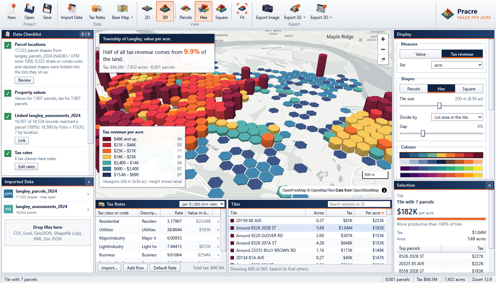
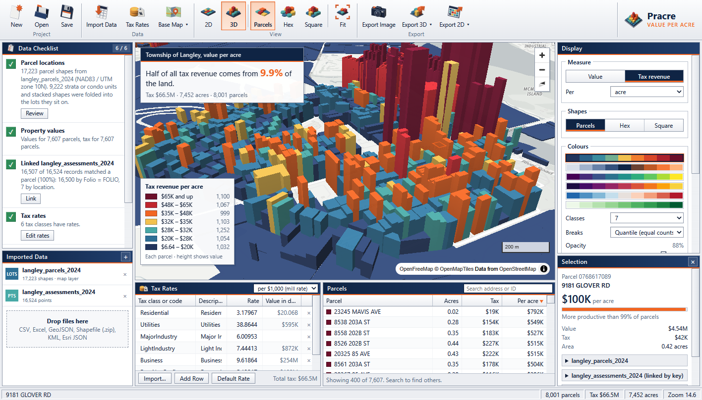
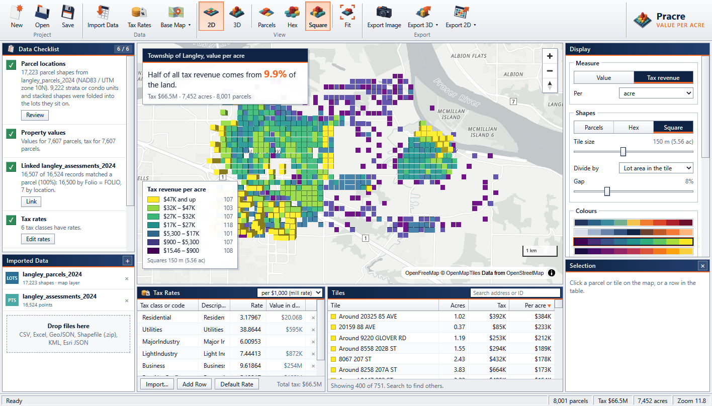
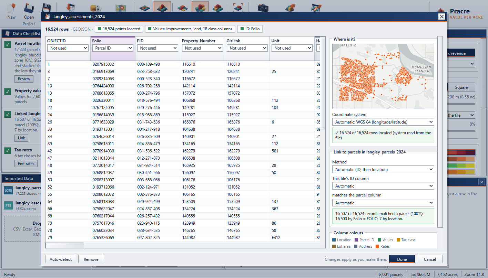

<p align="center"></p>

<h1 align="center">Pracre</h1>

<p align="center"><b>Value per acre maps for Strong Towns advocates.</b><br>Drop in parcel and assessment data, get a 2D or 3D map of what every acre of your town returns.</p>

<p align="center"><a href="https://github.com/strongtowns/Pracre/releases/latest"><b>Download for Windows, macOS and Linux</b></a></p>



## What it does

Pracre turns the files your municipality already publishes into value per acre maps. Import parcel shapes and assessment values in whatever format you have, and Pracre works out which columns hold IDs, values, tax classes, lot sizes and locations, links the files together and draws the result over OpenStreetMap. A checklist on the left says what is done and what is still missing.

The map shows which places pay their way. Tall red columns produce the most tax per acre, low blue ones the least. For the bundled Township of Langley sample, half of all tax revenue comes from under 4% of the land.

## Features

- **Any common format.** CSV, TSV, Excel (.xlsx), GeoJSON, Esri JSON from ArcGIS, zipped or loose Shapefiles, KML and KMZ. Drag files onto the window or use Import Data.
- **Any location encoding.** Parcel polygons or points, latitude and longitude columns (in either order), "lat, lon" in one column, degrees-minutes-seconds, WKT, WKB and GeoJSON geometry columns, MGRS / USNG grid references, UTM text such as "10U 525199 5432031", Plus codes and geohashes, or projected X/Y.
- **Every coordinate system.** All 7,800 EPSG and ESRI projected systems and 1,400 geographic ones are built in, so a bare code such as EPSG:2264 or an ArcGIS wkid works offline. Systems also come from .prj files (WKT1 or WKT2), GeoJSON and Esri metadata or EWKT. State Plane, UTM, national grids, Krovak, Swiss and Dutch grids, oblique and polar stereographic and the other projection methods parcel data uses all convert to within a centimetre of PROJ. Older datums such as NAD27, OSGB36, ED50 and Tokyo are shifted to WGS 84 with the regional Helmert transformation for where the data sits, usually within a few metres. Unlabelled coordinates are tried in every system near the map view, and the import window shows where they land; "Guess for This Area" ranks the systems again for any place on its map.
- **Values or tax, either works.** Total value, land plus improvements, one value column per tax class (Residential_Land, Business_Buildings and so on), or the tax amount itself. Add mill rates, percentages or fractions per tax class (or one default rate) to map tax revenue per acre. Exports that repeat every property for several roll years use the latest year.
- **Automatic linking.** Values in a separate file are joined by the ID both files share (folio, PID, APN, roll number, parcel number), found by comparing the actual values, then by location for anything left over.
- **Strata and condos handled.** Units stacked on their common property, or drawn as many small shapes at one civic address, are folded into the lot they sit on, so a townhouse complex reads as one productive lot instead of a hundred slivers.
- **Friendly column mapping.** Every guess is shown in an import window with colour-coded column headings. Change any of them from a drop-down; the map updates as you go.
- **2D and 3D views.** Parcels, hexagon tiles or square tiles from 25 m to 2 km, net (lot area) or gross (tile area) per acre, a 99th percentile cap for spikes, adjustable height, opacity and gap.
- **Clear legends.** Quantile, natural breaks (Jenks), logarithmic or equal interval classes, 3 to 12 brackets, six colour ramps, with exempt properties and missing lot areas shown separately.
- **Exports.** PNG images with title, legend and credits; self-contained 2D or 3D web maps with copy-and-paste embed code for your website; coloured 3D models (.glb) for Blender, PowerPoint or 3D viewers; GeoJSON and CSV for further analysis.
- **Projects.** Save everything, including the imported data, in one .pracre file that opens on any computer.
- **Offline friendly.** Everything but the base map runs locally; choose "None" as the base map to work without a connection.

| Parcels in 3D | Square tiles in 2D |
| --- | --- |
|  |  |



## Install

Download the file for your system from the [latest release](https://github.com/strongtowns/Pracre/releases/latest).

| System | File | Notes |
| --- | --- | --- |
| Windows 10 and 11 | `Pracre-Windows-x64-Setup.exe` | Installs Pracre and the .pracre file type. `Pracre-Windows-x64-Portable.zip` runs without installing. |
| macOS 12 or later (Intel and Apple silicon) | `Pracre-macOS-Universal.dmg` | Drag Pracre to Applications. The first time, right-click Pracre and choose Open, then Open again. |
| Ubuntu 22.04 or later, Debian 12 | `Pracre-Linux-x64.deb` | `sudo apt install ./Pracre-Linux-x64.deb` installs the WebKitGTK it needs. |
| Other Linux | `Pracre-Linux-x64.tar.gz` | Needs `libwebkit2gtk-4.1` and GTK 3. Run `./install.sh` to add it to your applications menu. |

Windows may show a SmartScreen notice for a new app; choose More info, then Run anyway.

## Quick start

1. Click **Try the Langley sample** to see a finished map, or **Import Data** to load your own.
2. Import your parcel layer (shapes or points) and your assessment table. Check the import window: if Pracre guessed a column wrong, change its role.
3. Fill in the **Tax Rates** table at the bottom to map tax revenue per acre. Tax classes found in your data are already listed.
4. Switch between **Parcels**, **Hex** and **Square**, and between **2D** and **3D**. Right-drag (or Ctrl-drag) tilts and turns the map.
5. Export an image, a web map or a 3D model, and save the project.

## How the numbers work

- **Value per acre** is a parcel's value divided by its lot area in acres (or hectares). Lot areas come from the parcel shapes, measured on the ellipsoid, or from a lot size column.
- **Tax per acre** uses the tax amount column when there is one. Otherwise each value is multiplied by the rate for its tax class, where a mill rate is per $1,000 of value.
- **Tiles** add up every parcel whose centre falls inside them. "Lot area in the tile" divides by the land those parcels cover, which ignores roads and parks; "Whole tile area" divides by the tile itself.
- **Exempt and $0 properties** are coloured grey and kept out of the class breaks, so parks and schools don't squash the scale.
- When two files both provide a value, the more specific one wins: taxable value over assessed value, a tax amount over a computed one.

## Data you can use

Most assessment authorities and municipal open data portals publish parcel boundaries and assessment rolls. Search your city or county's open data site for "parcels", "assessment", "tax roll" or "property". In BC, municipal open data portals and BC Assessment rolls work well; in the United States, county GIS and assessor sites usually offer parcel downloads with assessed values.

File > Sample Data has two bundled samples. The Township of Langley sample covers the whole township, from Township of Langley open data (2024 parcels and assessments) under the Open Government Licence - Township of Langley. The Port Huron sample has every parcel in the City of Port Huron, Michigan, with 2024 taxable values, from the city's parcel data.

Coordinate system parameters come from the EPSG Geodetic Parameter Dataset (© IOGP) and Esri's projection definitions, by way of PROJ's database. To refresh `epsg/epsg.txt.gz` after a PROJ release, run `python epsg/gen.py path/to/proj.db` from the `epsg` folder; `proj.db` ships with PROJ and with the pyproj package.

## Build from source

Pracre is written in Go with [Wails](https://wails.io) and draws its maps with [MapLibre GL JS](https://maplibre.org). The front end is plain HTML, CSS and JavaScript in `frontend/dist`, with no build step.

```bash
go install github.com/wailsapp/wails/v2/cmd/wails@v2.17.0
wails build -skipbindings
```

- **Windows** needs Go 1.25 or later. Add `-nsis` (with NSIS installed) for the installer.
- **macOS** needs the Xcode command line tools. Use `wails build -platform darwin/universal -skipbindings`.
- **Linux** needs `libgtk-3-dev` and `libwebkit2gtk-4.1-dev`. Use `wails build -tags webkit2_41 -skipbindings`.

`go test .` runs the projection, detection, tiling and 3D export tests. With the Township of Langley files from the Strong Towns ValuePerAcre2 repository beside this one, it also runs the full pipeline on 53,000 parcels.

Tagging a commit `v*` makes GitHub Actions build all three platforms and publish a release. macOS builds are ad-hoc signed; adding the `MACOS_CERTIFICATE`, `MACOS_CERTIFICATE_PASSWORD` and `MACOS_SIGNING_IDENTITY` secrets switches to Developer ID signing, and `APPLE_ID`, `APPLE_TEAM_ID` and `APPLE_APP_PASSWORD` add notarization.

### Artwork

The icons, app icon and illustrations are rendered in Blender from `art/render_art.py`:

```bash
blender -b --factory-startup -P art/render_art.py
python art/postprocess.py
```

## Credits

Base maps © [OpenStreetMap](https://www.openstreetmap.org/copyright) contributors, served by [OpenFreeMap](https://openfreemap.org) and the OpenStreetMap Foundation. Map rendering by [MapLibre GL JS](https://maplibre.org) (BSD-3-Clause). Excel import by [Excelize](https://github.com/xuri/excelize) (BSD-3-Clause).

## Licence

Pracre is free software under the [GNU General Public License v3](LICENSE).
